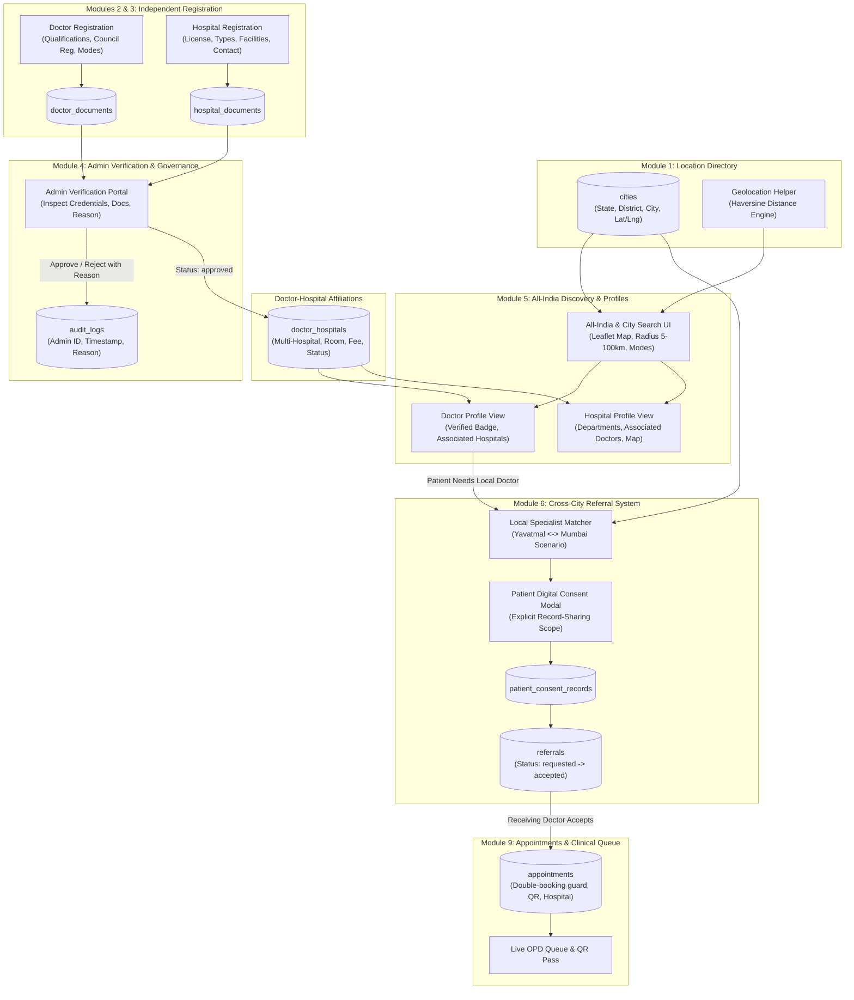

# CarePulse – City-Wise Doctor & Hospital Discovery, Independent Registration, Admin Verification & Referral Architecture

## Comprehensive Implementation Plan & Technical Blueprint

**Project Version:** 2.0.0  
**Phase:** Phase 1 – Implementation Plan & Database Migration Plan  
**Target Architecture:** HTML5, CSS3, Vanilla JS ES6+, Tailwind CSS CDN, Supabase PostgreSQL, Supabase Auth, Supabase Storage, Supabase Realtime  

---

## 1. System Architecture & Entity Flow Diagram

---

## 2. Detailed Module Breakdown & Specifications

### Module 1: Location Directory
* **Data Layer:** `cities` table with India-wide normalized records (Country, State, District, City, PIN code, Latitude, Longitude, Tier).
* **Search Modes:**
  1. **All-India:** Browse doctors and hospitals nationwide.
  2. **Hierarchical Selection:** State $\to$ District $\to$ City dropdown cascaded pickers.
  3. **Geolocation / Nearby:** Browser HTML5 Geolocation (`navigator.geolocation.getCurrentPosition`) strictly upon user consent.
  4. **Distance Math:** Client-side Haversine mathematical calculation:
     $$d = 2R \arcsin\left(\sqrt{\sin^2\left(\frac{\Delta\phi}{2}\right) + \cos(\phi_1)\cos(\phi_2)\sin^2\left(\frac{\Delta\lambda}{2}\right)}\right)$$
     with preset radius buttons: `5 km`, `10 km`, `25 km`, `50 km`, `100 km`.
* **State Persistence:** Users can change their active discovery location anytime in the header without modifying their profile's registered home address.

---

### Module 2: Independent Doctor Registration Workflow
* **Registration Page:** `register.html` extended or dedicated `doctor-register.html`.
* **Fields Captured:**
  * Personal & Contact: Full name, email, mobile phone, profile photograph, city, residential/clinic address.
  * Professional Credentials: Qualifications (e.g. MBBS, MD, DM), medical specialization, state medical council name, medical council registration number, year of registration, years of experience.
  * Practice Details: Consultation fee, consultation modes (`in_person`, `video`, `both`), initial hospital/clinic affiliations.
  * Document Uploads: State medical council registration certificate, degree certificates, government identity proof.
* **Verification Status States:** `draft` $\to$ `pending` $\to$ `under_review` $\to$ `approved` $\to$ `rejected` $\to$ `suspended`.
* **Public Visibility Rule:** `verification_status = 'approved' AND is_active = TRUE`. Non-approved doctors can never be found in search.

---

### Module 3: Independent Hospital Registration Workflow
* **Registration Flow:** Dedicated hospital registration interface (`hospital-register.html`).
* **Fields Captured:**
  * Organization Details: Hospital legal name, hospital type (*Government, Private Multi-specialty, Super-specialty, Clinic*), establishment license number, clinical registration number.
  * Location: State, district, city, full street address, PIN code, latitude/longitude.
  * Contact: Official hospital email, general phone, 24x7 emergency phone, website.
  * Capacity & Facilities: Total bed count, facilities checkbox array (*ICU, Emergency 24x7, Pharmacy, Laboratory, Ambulance, Cath Lab, Dialysis, NICU*).
  * Authorized Signatory: Full name, designation, direct phone.
  * Verification Documents: Clinical establishment license, NABH/NABL accreditation certificates, fire safety NOC.
* **Verification Status States:** `draft` $\to$ `pending` $\to$ `under_review` $\to$ `approved` $\to$ `rejected` $\to$ `suspended`.

---

### Module 4: Admin Verification & Governance Center
* **Location:** Admin Portal (`admin/verification.html` or integrated tabs in `admin/doctors.html` & `admin/hospitals.html`).
* **Core Capabilities:**
  * Dedicated Doctor Verification Queue & Hospital Verification Queue.
  * Embedded credential & document inspection modal (view uploaded certificate, check council number).
  * **Approve / Reject Action with Mandatory Justification:** Admin must select approval status and submit a written rationale.
  * **No Self-Approval:** Server and client constraints prevent an admin from approving their own profile.
  * **Suspension & Restoration:** Ability to suspend problematic profiles with reason and restore them when resolved.
  * **Immutable Audit Trail:** All verification actions write to `audit_logs` storing `admin_id`, `entity_type`, `entity_id`, `action`, `decision`, `reason`, `timestamp`.

---

### Module 5: All-India Discovery & Profiles
* **Search Interface (`doctors.html` & `hospitals.html`):**
  * Dynamic toggle: "Specialist Doctors" vs. "Hospitals & Medical Centers".
  * Comprehensive filters: Location (State/City/Nearby Radius), Specialty/Department, Experience, Consultation Mode (In-Person / Online Video), Realtime Today's Availability, Rating.
* **Individual Doctor Profile (`doctor-profile.html`):**
  * Verified Doctor Badge with Council registration details.
  * Associated hospitals with OPD room numbers and fees.
  * Consultation modes supported (In-Person Clinic Visit / Video Consultation).
  * Booking wizard slot selection.
  * "Request Cross-City Referral / Find Local Specialist" action button.
* **Individual Hospital Profile (`hospital-profile.html`):**
  * Verified Hospital Badge & License details.
  * Interactive Leaflet Map with exact coordinates.
  * Clinical departments and accredited facilities pills.
  * Associated doctor roster with 1-click booking.
  * 24x7 emergency contact hotline.

---

### Module 6: Cross-City Referral System (The Yavatmal $\leftrightarrow$ Mumbai Workflow)
* **Real-World Patient Journey:**
  1. Patient in **Yavatmal** searches for a Super-Specialist Cardiologist in **Mumbai**.
  2. Patient clicks **"Find Local Specialist / Request Referral"** on the Mumbai doctor's profile.
  3. CarePulse automatically filters approved doctors in **Yavatmal** and adjacent districts (e.g. Amravati, Nagpur) sharing the same specialty.
  4. If a local doctor exists, patient compares profiles and clicks **"Initiate Referral Request"**.
  5. If no local doctor exists in Yavatmal, CarePulse immediately offers **Online Video Teleconsultation** with the Mumbai specialist or nearby Nagpur centers.
  6. **Mandatory Patient Consent:** A formal digital consent modal appears requiring explicit acknowledgment:
     > *"I authorize CarePulse to share my clinical summary, provisional symptoms, and medical history with the receiving specialist."*
     The system logs `patient_consent_records` with timestamp, IP, and scope.
  7. **Referring Doctor Dispatch:** Referral is created with status `'requested'`.
  8. **Receiving Doctor Decision:** Receiving doctor receives real-time notification in their Doctor Portal, reviews case notes, and clicks **"Accept Referral"** or **"Decline with Reason"**.
  9. **Patient Notification & Linked Appointment:** Once accepted, the patient receives an in-app and email notification and can book a consultation slot. The appointment links to `referral_id` without overwriting prior records.

---

### Module 7: Backward Compatibility & Database Safety
* **Zero Disruption Guarantee:**
  * `appointments.hospital_id` and `appointments.referral_id` are nullable.
  * Pre-seeded `"CarePulse Central Hospital"` (`c0000000-0000-0000-0000-000000000001`) guarantees that all existing appointments, tests, and QR codes retain complete validity.
  * All existing doctors are automatically backfilled as `'approved'` so no existing doctor disappears.
  * Strict unique double-booking index `idx_prevent_double_booking` remains completely untouched.

---

## 3. Implementation Phasing Strategy

| Phase | Description | Deliverables |
|---|---|---|
| **Phase 1 (Current)** | Implementation Plan & Database Migration Plan | `sql/city_hospital_referral_migration.sql`, `IMPLEMENTATION_PLAN_MODULES.md`, Phase 1 schema validation tests. |
| **Phase 2** | Location & Directory Engine | Geolocation service, city-picker UI, Haversine nearby distance calculator, client-side caching. |
| **Phase 3** | Independent Doctor & Hospital Registration & Admin Verification | Registration forms, Supabase document uploads, Admin verification dashboard with approve/reject reasons and audit logs. |
| **Phase 4** | All-India Discovery & Enhanced Profiles | Updated `doctors.html`, new `hospital-profile.html`, Leaflet maps, multi-hospital badges, consultation mode filters. |
| **Phase 5** | Cross-City Referral System | Yavatmal-Mumbai matching engine, patient consent modal, doctor review dashboard, referral status tracking. |
| **Phase 6** | Appointment System Integration | Booking integration across multiple hospital affiliations, teleconsultation links, QR pass updates. |
| **Phase 7** | Comprehensive Testing, Security & Optimization | End-to-end workflow verification, RLS audits, mobile responsiveness tests, zero-regression certification. |

