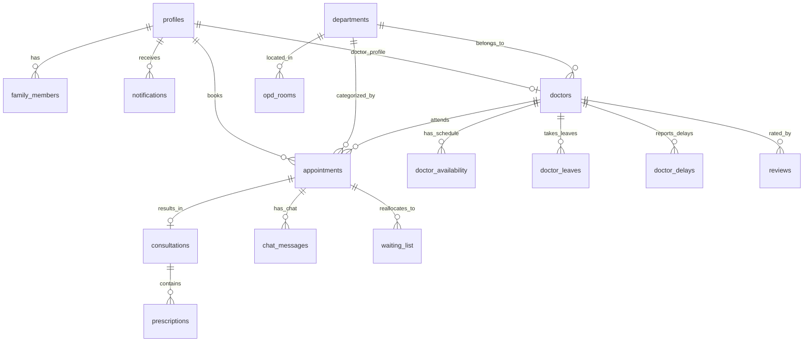
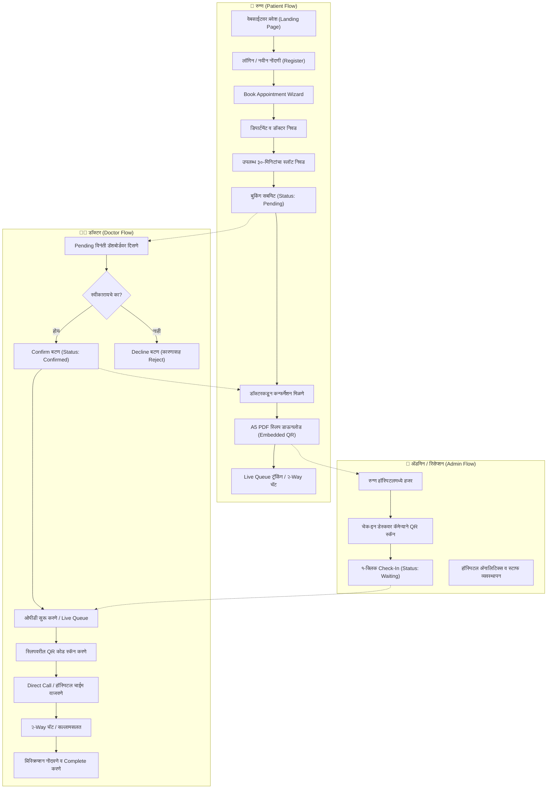
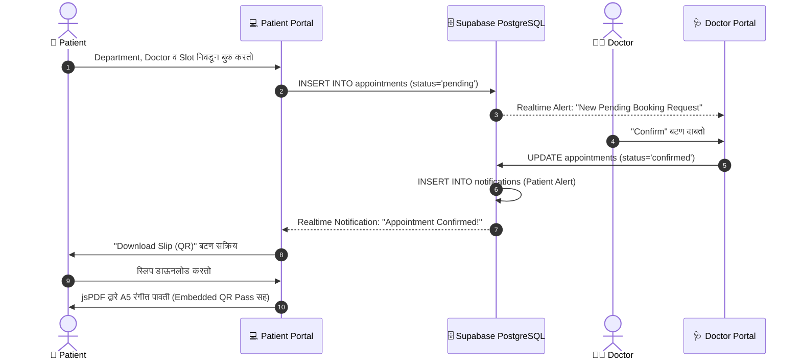
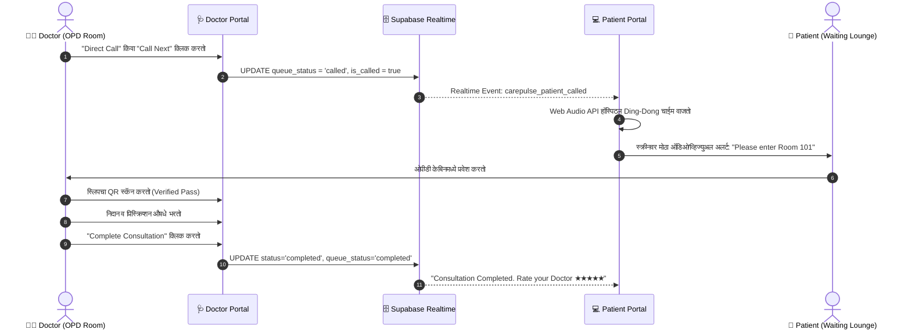
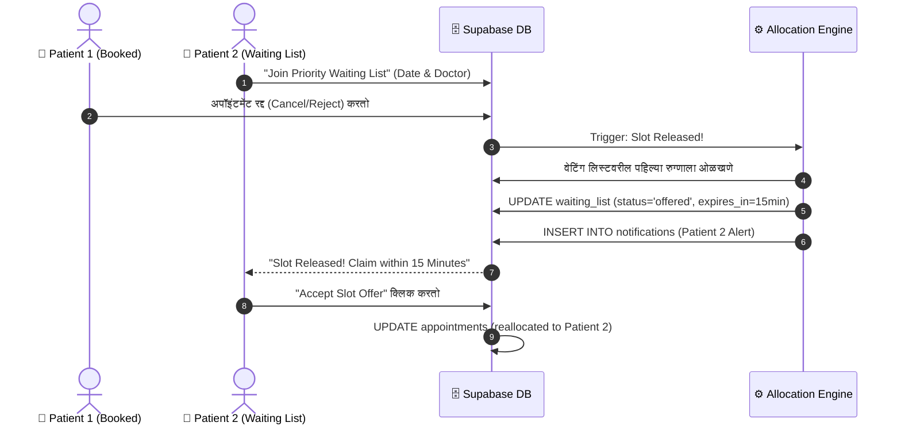
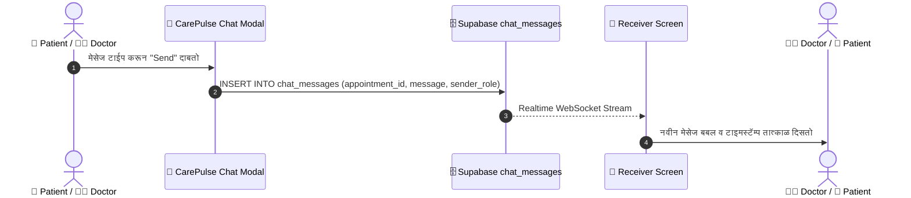

# 🏥 CarePulse - Hospital Management System
# 📘 संपूर्ण सिस्टीम कार्यप्रणाली (All-in-One Complete Website Workflow & Architecture Guide)

> **CarePulse** ही एक संपूर्ण, सुरक्षित आणि **Realtime Supabase PostgreSQL** आधारित **हॉस्पिटल अपॉइंटमेंट बुकिंग, डिजिटल टोकन सिस्टीम, 2-Way डॉक्टर-पेशंट कन्सल्टेशन चॅट, Direct Audio Chime Calling आणि Live OPD Queue मॅनेजमेंट** वेब ॲप्लिकेशन आहे.
>
> या एकाच फाईलमध्ये संपूर्ण वेबसाईटचे सर्व ३६ पेजेस, सर्व ११ सिलेक्टेड फिचर्स, डेटाबेस स्ट्रक्चर, सर्व फ्लोचार्ट्स (Mermaid Diagrams), लॉगिन क्रेडेंशियल्स आणि रिअल-टाइम कार्यप्रणाली सविस्तर मांडली आहे.

---

## 📑 अनुक्रमणिका (Table of Contents)
1. [प्रोजेक्ट विहंगावलोकन व आर्किटेक्चर (Project Overview & Architecture)](#1-project-overview--architecture)
2. [वापरलेले तंत्रज्ञान (Technology Stack)](#2-technology-stack)
3. [डेटाबेस आर्किटेक्चर व १४ टेबल्स (Database Schema & 14 Tables)](#3-database-schema--14-tables)
4. [वेबसाईट मधील सर्व ३६ पेजेस व फिचर्स (All 36 Pages & Features Breakdown)](#4-all-36-pages--features-breakdown)
   - [४.१ सार्वजनिक पेजेस (Public Website - 11 Pages)](#४१-सार्वजनिक-पेजेस-public-website---11-pages)
   - [४.२ पेशंट पोर्टल (Patient Portal - 8 Pages)](#४२-पेशंट-पोर्टल-patient-portal---8-pages)
   - [४.३ डॉक्टर पोर्टल (Doctor Portal - 8 Pages)](#४३-डॉक्टर-पोर्टल-doctor-portal---8-pages)
   - [४.४ ॲडमिन पोर्टल (Admin Control Center - 9 Pages)](#४४-ॲडमिन-पोर्टल-admin-control-center---9-pages)
5. [११ मुख्य फीचर्सचे सविस्तर कार्य (11 Core Implemented Features)](#5-11-core-implemented-features)
   - [Feature 1: QR Code Generation + Actual Live Camera Scanner](#feature-1-qr-code-generation--actual-live-camera-scanner)
   - [Feature 2: Patient Appointment Rescheduling](#feature-2-patient-appointment-rescheduling)
   - [Feature 3: Doctor Availability Auto Calculation](#feature-3-doctor-availability-auto-calculation)
   - [Feature 4: Automated 24h & 1h Appointment Reminders](#feature-4-automated-24h--1h-appointment-reminders)
   - [Feature 5: Doctor Delay Management & Dynamic Queue Recalculation](#feature-5-doctor-delay-management--dynamic-queue-recalculation)
   - [Feature 6: Priority Waiting List & Auto Slot Reallocation](#feature-6-priority-waiting-list--auto-slot-reallocation)
   - [Feature 7: Patient End-to-End Workflow](#feature-7-patient-end-to-end-workflow)
   - [Feature 8: Doctor Clinical Workflow](#feature-8-doctor-clinical-workflow)
   - [Feature 9: Admin Oversight & Operational Management](#feature-9-admin-oversight--operational-management)
   - [Feature 10: Mobile Responsiveness & Hardware Camera Support](#feature-10-mobile-responsiveness--hardware-camera-support)
   - [Feature 11: Database RLS Security, Constraints & Integrity](#feature-11-database-rls-security-constraints--integrity)
6. [नवीन ॲडव्हान्स कम्युनिकेशन व व्हेरिफिकेशन फीचर्स (Advanced Interaction Features)](#6-advanced-interaction-features)
   - [६.१ डॉक्टर अपॉइंटमेंट स्वीकृती (Confirm / Decline Workflow)](#६१-डॉक्टर-अपॉइंटमेंट-स्वीकृती-confirm--decline-workflow)
   - [६.२ वेब नोटिफिकेशन व A5 PDF स्लिप (Embedded QR Code)](#६२-वेब-नोटिफिकेशन-व-a5-pdf-स्लिप-embedded-qr-code)
   - [६.३ डॉक्टर डायरेक्ट पेशंट कॉल (Web Audio API Hospital Chime)](#६३-डॉक्टर-डायरेक्ट-पेशंट-कॉल-web-audio-api-hospital-chime)
   - [६.४ २-Way Realtime Consultation Chat (Database Persistent)](#६४-२-way-realtime-consultation-chat-database-persistent)
   - [६.५ रिअल-टाइम लाइव्ह ओपीडी रांग (Realtime OPD Queue Sync)](#६५-रिअल-टाइम-लाइव्ह-ओपीडी-रांग-realtime-opd-queue-sync)
7. [व्हिज्युअल वर्कफ्लो व आकृत्या (Mermaid Workflow & Sequence Diagrams)](#7-mermaid-workflow--sequence-diagrams)
   - [७.१ मास्टर सिस्टम फ्लोचार्ट (Master System Flowchart)](#७१-मास्टर-सिस्टम-फ्लोचार्ट-master-system-flowchart)
   - [७.२ पेशंट बुकिंग, डॉक्टर कन्फर्मेशन व स्लिप जनरेशन सिक्वेन्स](#७२-पेशंट-बुकिंग-डॉक्टर-कन्फर्मेशन-व-स्लिप-जनरेशन-सिक्वेन्स)
   - [७.३ ओपीडी कॉल, डायरेक्ट चाईम व कन्सल्टेशन सिक्वेन्स](#७३-ओपीडी-कॉल-डायरेक्ट-चाईम-व-कन्सल्टेशन-सिक्वेन्स)
   - [७.४ वेटिंग लिस्ट व ऑटो स्लॉट रिॲलोकेशन सिक्वेन्स](#७४-वेटिंग-लिस्ट-व-ऑटो-स्लॉट-रिॲलोकेशन-सिक्वेन्स)
   - [७.५ २-Way कन्सल्टेशन चॅट सिक्वेन्स](#७५-२-way-कन्सल्टेशन-चॅट-सिक्वेन्स)
8. [सर्व लॉगिन क्रेडेंशियल्स व युझर रोल्स (Login IDs & Passwords)](#8-login-ids--passwords)
9. [डेटाबेस सेटअप व रनिंग गाईड (Setup & Execution Guide)](#9-setup--execution-guide)

---

## 1. Project Overview & Architecture

CarePulse ही आधुनिक हॉस्पिटल्समधील गर्दी, प्रतीक्षेचा ताण आणि डॉक्टर-रुग्ण संवाद सुलभ करण्यासाठी तयार केलेली पूर्णपणे क्लायंट-सर्व्हर विरहित (Serverless Architecture) रिअल-टाइम सिस्टीम आहे:
* **रुग्णांसाठी (Patient):** घरबसल्या स्पेशालिस्ट डॉक्टर शोधणे, ३० मिनिटांचा उपलब्ध स्लॉट निवडणे, युनिक डिजिटल टोकन (`CARD-001`) व स्कॅन करण्यायोग्य PDF स्लिप मिळवणे, डॉक्टरशी २-वे चॅट करणे आणि ओपीडी रांग मोबाईलवर ट्रॅक करणे.
* **डॉक्टरांसाठी (Doctor):** येणाऱ्या अपॉइंटमेंट विनंत्या Confirm/Reject करणे, ओपीडी रूममधून १-क्लिकवर पुढील पेशंटला बोलावणे, चाईम वाजवणे किंवा डायरेक्ट फोन लावणे, स्लिपचा QR कोड स्कॅन करणे आणि डिजिटल प्रिस्क्रिप्शन भरणे.
* **प्रशासनासाठी (Admin):** संपूर्ण हॉस्पिटलचे लाईव्ह चार्ट्स (Chart.js), डॉक्टर व्हेरिफिकेशन, रुग्ण यादी, चेक-इन डेस्क कॅमेरा QR स्कॅनर, ओपीडी रूम्स, वेटिंग लिस्ट मॅनेजमेंट आणि सुरक्षा ऑडिट लॉग्ज.

---

## 2. Technology Stack

| घटक (Layer) | तंत्रज्ञान (Technology) | सविस्तर उपयोग (Purpose) |
|---|---|---|
| **Frontend Core** | HTML5, CSS3, Modern ES6+ JavaScript | फ्रेमवर्कच्या ओझ्यात अडकल्याशिवाय वेगवान Vanilla JS आर्किटेक्चर |
| **Styling & Design** | Tailwind CSS (CDN), Custom CSS Variables | आधुनिक मेडिकल कलर पॅलेट (Teal, Sky, Emerald, Slate), रिस्पॉन्सिव्ह ग्रिड |
| **Icons & Media** | Lucide Icons (SVG), Unsplash Verified Medical Photography | स्वच्छ, व्यावसायिक आणि युझर-फ्रेंडली युझर इंटरफेस |
| **Database & Auth** | Supabase (PostgreSQL 15), Row Level Security (RLS) | क्लाउड रिलेशनल डेटाबेस, सुरक्षित सेशन मॅनेजमेंट आणि रोल आधारित अधिकार |
| **Realtime Engine** | Supabase Realtime Channels (PostgreSQL CDC) | WebSocket द्वारे पेज रिफ्रेश न करता डेटा सिंक, लाइव्ह चॅट आणि ओपीडी रांग |
| **QR Code Engine** | QRCode.js & Html5-Qrcode (v2.3.8) | हाय-रेझोल्यूशन QR जनरेशन आणि मोबाईल/लॅपटॉप हार्डवेअर कॅमेऱ्याने थेट स्कॅनिंग |
| **Audio Alerting** | Modern Web Audio API | कोणत्याही ऑडिओ फाईल डाऊनलोडशिवाय २-टोन हॉस्पिटल कॉल चाईम (Ding-Dong बेल) |
| **PDF Slip Engine** | jsPDF (v2.5.1 UMD) | स्कॅन करण्यायोग्य QR कोडसह अधिकृत A5 साईज हॉस्पिटल अपॉइंटमेंट स्लिप डाऊनलोड |
| **Analytics Engine**| Chart.js | ७-दिवसांचे बुकिंग व्हॉल्यूम आणि डिपार्टमेंट विभागणीचे इंटरॲक्टिव्ह आलेख |

---

## 3. Database Schema & 14 Tables

सिस्टीममध्ये **१४ सुसंघटित PostgreSQL टेबल्स** आहेत:



### टेबल्सची सविस्तर माहिती:
1. **`profiles`**: वापरकर्त्यांचे मूळ प्रोफाईल (नाव, ईमेल, फोन, रोल: `patient`/`doctor`/`admin`, जन्मतारीख, रक्तगट, पत्ता, फोटो).
2. **`departments`**: वैद्यकीय विभाग (Cardiology, Neurology, Orthopedics, Dermatology, Pediatrics, General Medicine, Dentistry, Ophthalmology).
3. **`opd_rooms`**: ओपीडी खोल्यांची माहिती (Room 101, Room 204 इ.) आणि त्यांची विंग/फ्लोअर/स्टेटस.
4. **`doctors`**: डॉक्टरांची माहिती (स्पेशलायझेशन, पदवी, अनुभव, फी, रेटिंग, व्हेरिफिकेशन `is_verified`).
5. **`doctor_availability`**: डॉक्टरांचे साप्ताहिक वार (Monday–Sunday), ओपीडी कामाचे तास (Start/End Time) आणि स्लॉट कालावधी (३० मिनिटे).
6. **`doctor_leaves`**: डॉक्टरांच्या मंजूर सुट्ट्या (Leave Date, Reason).
7. **`doctor_delays`**: डॉक्टरांनी नोंदवलेला ओपीडी उशीर (Delay Minutes, Reason, Created At).
8. **`family_members`**: रुग्णाच्या कुटुंबातील सदस्य (आई, वडील, जोडीदार, मुले).
9. **`appointments`**: मुख्य अपॉइंटमेंट बुकिंग रेकॉर्ड (टोकन नंबर, तारीख, वेळ स्लॉट, `status`: `pending`/`confirmed`/`in-progress`/`completed`/`cancelled`/`rejected`, `queue_status`: `waiting`/`called`/`in-room`/`completed`, `verification_hash`, `is_called`).
10. **`waiting_list`**: स्लॉट फुल्ल झाल्यावर प्राधान्य क्रमाने जोडलेली वेटिंग लिस्ट (`preferred_date`, `status`: `waiting`/`offered`/`allocated`/`expired`).
11. **`chat_messages`**: डॉक्टर आणि पेशंटमधील २-वे रिअल-टाइम संदेश (`appointment_id`, `doctor_id`, `patient_id`, `sender_id`, `sender_role`, `message`, `is_read`).
12. **`consultations`**: डॉक्टरने दिलेले निदान (Diagnosis), कन्सल्टेशन नोट्स व फॉलो-अप तारीख.
13. **`prescriptions`**: औषधांची यादी, डोस, वारंवारता आणि कालावधी.
14. **`notifications`**: इन-ॲप नोटिफिकेशन्स (कन्फर्मेशन, रिमाइंडर, ओपीडी कॉल, स्टेटस बदल, डिले अलर्ट).

---

## 4. All 36 Pages & Features Breakdown

### ४.१ सार्वजनिक पेजेस (Public Website - 11 Pages)
* **[index.html](file:///p:/PRAJWAL/Pallavi/Hospital%20Management%20System/index.html)** - लँडिंग पेज, हॉस्पिटल विहंगावलोकन, क्विक डॉक्टर सर्च, डिपार्टमेंट ग्रिड, आपत्कालीन हेल्पलाईन.
* **[doctors.html](file:///p:/PRAJWAL/Pallavi/Hospital%20Management%20System/doctors.html)** - हॉस्पिटलच्या सर्व स्पेशालिस्ट डॉक्टरांची डिरेक्टरी, सर्च, विभागानुसार फिल्टर, रेटिंग्ज.
* **[doctor-profile.html](file:///p:/PRAJWAL/Pallavi/Hospital%20Management%20System/doctor-profile.html)** - डॉक्टरचे स्वतंत्र प्रोफाईल, अनुभव, फी, पदवी, ओपीडी वेळापत्रक आणि रुग्णांचे रिव्ह्यूज.
* **[departments.html](file:///p:/PRAJWAL/Pallavi/Hospital%20Management%20System/departments.html)** - कार्डिओलॉजी, न्यूरोलॉजी इत्यादी सर्व वैद्यकीय विभागांची सविस्तर माहिती.
* **[about.html](file:///p:/PRAJWAL/Pallavi/Hospital%20Management%20System/about.html)** - हॉस्पिटलची उद्दिष्टे, आंतरराष्ट्रीय सुविधा, अत्याधुनिक उपकरणे.
* **[contact.html](file:///p:/PRAJWAL/Pallavi/Hospital%20Management%20System/contact.html)** - संपर्क माहिती, गूगल मॅप, रुग्ण चौकशी फॉर्म.
* **[login.html](file:///p:/PRAJWAL/Pallavi/Hospital%20Management%20System/login.html)** - सुरक्षित ईमेल/पासवर्ड लॉगिन (रोलनुसार पेशंट, डॉक्टर किंवा ॲडमिन डॅशबोर्डवर स्वयंचलित रिडायरेक्शन).
* **[register.html](file:///p:/PRAJWAL/Pallavi/Hospital%20Management%20System/register.html)** - नवीन रुग्ण नोंदणी फॉर्म (नाव, ईमेल, पासवर्ड, फोन, लिंग, जन्मतारीख).
* **[email-confirmation.html](file:///p:/PRAJWAL/Pallavi/Hospital%20Management%20System/email-confirmation.html)** - ईमेल व्हेरिफिकेशन स्क्रीन.
* **[forgot-password.html](file:///p:/PRAJWAL/Pallavi/Hospital%20Management%20System/forgot-password.html)** - पासवर्ड रीसेट लिंक विनंती स्क्रीन.
* **[reset-password.html](file:///p:/PRAJWAL/Pallavi/Hospital%20Management%20System/reset-password.html)** - नवीन पासवर्ड सेट करण्याची सुरक्षित स्क्रीन.

---

### ४.२ पेशंट पोर्टल (Patient Portal - 8 Pages)
* **[patient/index.html](file:///p:/PRAJWAL/Pallavi/Hospital%20Management%20System/patient/index.html)** - पेशंट होम डॅशबोर्ड:
  * आगामी कन्सल्टेशन कार्ड (`Next Consultation`) - डॉक्टरचे नाव, तारीख, वेळ आणि टोकन.
  * **"Download Slip (QR)"** बटण - A5 PDF स्लिप डाऊनलोड (स्कॅन करण्यायोग्य QR सह).
  * **"Chat with Doctor"** बटण - डॉक्टरशी थेट २-वे लाइव्ह चॅट.
  * **"Open Live Queue"** बटण - लाइव्ह ओपीडी रांग ट्रॅकर उघडणे.
* **[patient/book-appointment.html](file:///p:/PRAJWAL/Pallavi/Hospital%20Management%20System/patient/book-appointment.html)** - स्मार्ट बुकिंग विझार्ड:
  * विभाग व डॉक्टर निवडणे.
  * तारीख निवडणे आणि डॉक्टरच्या सुट्ट्या/वेळापत्रकानुसार रिअल-टाइम स्लॉट कॅल्क्युलेशन.
  * आधीच बुक झालेले स्लॉट्स ब्लॉक असणे. स्लॉट फुल्ल असल्यास **"Join Priority Waiting List"** चा पर्याय.
  * बुकिंग पूर्ण झाल्यावर तात्काळ `Pending` रिक्वेस्ट नोंदवणे व डिजिटल टोकन मिळणे.
* **[patient/appointments.html](file:///p:/PRAJWAL/Pallavi/Hospital%20Management%20System/patient/appointments.html)** - मास्टर अपॉइंटमेंट मॅनेजर:
  * सर्व सक्रिय, पूर्ण आणि रद्द झालेल्या अपॉइंटमेंट्सची यादी.
  * **"Reschedule"** मोडल - नवीन उपलब्ध तारीख व स्लॉट निवडून रीशेड्युल करण्याची सुविधा.
  * **"Priority Waiting Offers"** बॅनर - कॅन्सल झालेला स्लॉट रिलीज झाल्यावर मिळणारी ऑफर.
  * **"Download Slip (QR)"** व **"Chat with Doctor"** बटन्स.
* **[patient/appointment-details.html](file:///p:/PRAJWAL/Pallavi/Hospital%20Management%20System/patient/appointment-details.html)** - अपॉइंटमेंट सविस्तर माहिती:
  * कन्सल्टेशन नोट्स, प्रिस्क्रिप्शन औषधांची यादी, फॉलो-अप तारीख, QR कोड आणि २-वे चॅट.
* **[patient/queue-status.html](file:///p:/PRAJWAL/Pallavi/Hospital%20Management%20System/patient/queue-status.html)** - लाईव्ह ओपीडी रांग ट्रॅकर:
  * Serving Now टोकन, Your Token, तुमच्या पुढे असलेले पेशंट्स आणि अचूक प्रतीक्षा वेळ (डिले मिनिटांसह).
* **[patient/family-members.html](file:///p:/PRAJWAL/Pallavi/Hospital%20Management%20System/patient/family-members.html)** - कुटुंबातील सदस्यांची नोंद व त्यांच्या नावे अपॉइंटमेंट बुकिंग.
* **[patient/notifications.html](file:///p:/PRAJWAL/Pallavi/Hospital%20Management%20System/patient/notifications.html)** - २४ तास व १ तास अगोदर मिळणारे रिमाइंडर्स आणि ओपीडी कॉलिंग नोटिफिकेशन्स.
* **[patient/profile.html](file:///p:/PRAJWAL/Pallavi/Hospital%20Management%20System/patient/profile.html)** - वैयक्तिक प्रोफाईल, वैद्यकीय इतिहास, रक्तगट आणि आपत्कालीन संपर्क.

---

### ४.३ डॉक्टर पोर्टल (Doctor Portal - 8 Pages)
* **[doctor/index.html](file:///p:/PRAJWAL/Pallavi/Hospital%20Management%20System/doctor/index.html)** - डॉक्टर डॅशबोर्ड:
  * आजच्या एकूण अपॉइंटमेंट्स, प्रतीक्षेतील रुग्ण आणि पूर्ण तपासण्यांची थेट आकडेवारी.
  * **"Scan Patient QR"** - पेशंटची स्लिप किंवा मोबाईल QR स्कॅन करण्यासाठी कॅमेरा मोडल.
  * **"Pending Booking Requests"** - रुग्णांच्या नवीन बुकिंग विनंत्या स्वीकारणे (`Confirm`) किंवा नाकारणे (`Decline`).
  * **"Active Consultation Banner"** - सध्या केबिनमध्ये असलेल्या पेशंटची माहिती आणि प्रिस्क्रिप्शन नोट्स.
  * **"Call & Start Consultation"** - रांगेतील पुढील पेशंटला बोलावणे.
* **[doctor/appointments.html](file:///p:/PRAJWAL/Pallavi/Hospital%20Management%20System/doctor/appointments.html)** - अपॉइंटमेंट व्यवस्थापन:
  * तारीख आणि स्टेटस फिल्टर्ससह संपूर्ण यादी.
  * `Pending` असल्यास **Accept (✓)** / **Decline (✗)** ॲक्शन्स.
  * `Confirmed` असल्यास **Start**, **Direct Call (📞)**, **Chat (💬)** आणि **Slip (📄)** ॲक्शन्स.
  * `In-Progress` असल्यास **Complete Consultation** व प्रिस्क्रिप्शन नोंदवणे.
* **[doctor/queue.html](file:///p:/PRAJWAL/Pallavi/Hospital%20Management%20System/doctor/queue.html)** - लाईव्ह ओपीडी रांग नियंत्रण:
  * प्रत्यक्ष ओपीडी सुरू ठेवणे, रुग्णाला १-क्लिकवर बोलावणे, चाईम वाजवणे आणि तपासणी पूर्ण करणे.
  * **"Report OPD Delay"** मोडल - १५, ३०, ४५ मिनिटे उशीर कारणासह ब्रॉडकास्ट करणे.
  * **"Scan Patient QR"** - केबिनमध्ये आलेल्या रुग्णाचा पास स्कॅन करून थेट ॲडमिट करणे.
* **[doctor/schedule.html](file:///p:/PRAJWAL/Pallavi/Hospital%20Management%20System/doctor/schedule.html)** - साप्ताहिक वेळापत्रक नियोजन (सोमवार ते रविवारचे कामाचे तास आणि ३०-मिनिटांचे स्लॉट्स).
* **[doctor/leaves.html](file:///p:/PRAJWAL/Pallavi/Hospital%20Management%20System/doctor/leaves.html)** - सुट्ट्यांचे नियोजन (रजेच्या दिवशी रुग्णांना बुकिंग स्लॉट्स दिसत नाहीत).
* **[doctor/patients.html](file:///p:/PRAJWAL/Pallavi/Hospital%20Management%20System/doctor/patients.html)** - तपासलेल्या रुग्णांची डिरेक्टरी आणि त्यांचा जुना वैद्यकीय इतिहास.
* **[doctor/reviews.html](file:///p:/PRAJWAL/Pallavi/Hospital%20Management%20System/doctor/reviews.html)** - रुग्णांनी दिलेले १ ते ५ स्टार रेटिंग्ज आणि फीडबॅक.
* **[doctor/profile.html](file:///p:/PRAJWAL/Pallavi/Hospital%20Management%20System/doctor/profile.html)** - डॉक्टर प्रोफाईल, स्पेशलायझेशन, पदवी आणि कन्सल्टेशन फी.

---

### ४.४ ॲडमिन पोर्टल (Admin Control Center - 9 Pages)
* **[admin/index.html](file:///p:/PRAJWAL/Pallavi/Hospital%20Management%20System/admin/index.html)** - कमांड सेंटर व ॲनालिटिक्स:
  * Chart.js ग्राफ्स - ७ दिवसांचे अपॉइंटमेंट व्हॉल्यूम, स्टेटस विभागणी आणि विभागवार कार्यक्षमता.
  * **"Scan Patient QR"** - नेव्हबार आणि हेडरमध्ये थेट कॅमेरा स्कॅनर शॉर्टकट.
* **[admin/verify-appointment.html](file:///p:/PRAJWAL/Pallavi/Hospital%20Management%20System/admin/verify-appointment.html)** - ओपीडी चेक-इन काउंटर:
  * लॅपटॉप/मोबाईलचा लाईव्ह कॅमेरा वापरून पेशंटच्या स्लिपवरील QR स्कॅन करणे किंवा मॅन्युअल टोकन तपासणे.
  * डेटाबेसवरून व्हेरिफाय करून १-क्लिकमध्ये **Checked-In (Waiting)** मार्क करणे.
* **[admin/appointments.html](file:///p:/PRAJWAL/Pallavi/Hospital%20Management%20System/admin/appointments.html)** - मास्टर अपॉइंटमेंट व वेटिंग लिस्ट कंट्रोल:
  * सर्व अपॉइंटमेंट्सची यादी, नवीन बुक करणे, स्लॉट बदलणे किंवा रद्द करणे.
  * **Waiting List Management View** - वेटिंगवरील रुग्णांची यादी आणि स्लॉट वाटपाचे नियंत्रण.
  * **Doctor Delay Oversight View** - कोणत्या डॉक्टरने किती डिले लावला आहे त्याचे थेट नियंत्रण.
* **[admin/doctors.html](file:///p:/PRAJWAL/Pallavi/Hospital%20Management%20System/admin/doctors.html)** - डॉक्टर स्टाफ व्यवस्थापन:
  * नवीन डॉक्टर जोडणे, संपादित करणे किंवा हटवणे.
  * १-क्लिक **Verified/Unverified** आणि **Available/Away** टॉगल बटन्स.
* **[admin/departments.html](file:///p:/PRAJWAL/Pallavi/Hospital%20Management%20System/admin/departments.html)** - वैद्यकीय विभाग जोडणे, संपादित करणे व प्रमुख डॉक्टर नियुक्त करणे.
* **[admin/rooms.html](file:///p:/PRAJWAL/Pallavi/Hospital%20Management%20System/admin/rooms.html)** - ओपीडी रूम्स, विंग, फ्लोअर आणि कार्यरत डॉक्टर वाटप.
* **[admin/patients.html](file:///p:/PRAJWAL/Pallavi/Hospital%20Management%20System/admin/patients.html)** - नोंदणीकृत रुग्णांची डिरेक्टरी, इतिहास आणि खाते स्टेटस.
* **[admin/reports.html](file:///p:/PRAJWAL/Pallavi/Hospital%20Management%20System/admin/reports.html)** - हॉस्पिटल महसूल, दैनंदिन ओपीडी अहवाल आणि एक्सपोर्ट (CSV/PDF).
* **[admin/audit-logs.html](file:///p:/PRAJWAL/Pallavi/Hospital%20Management%20System/admin/audit-logs.html)** - सिस्टीममधील प्रत्येक घडामोडीची सुरक्षित ऑडिट नोंद (कोणत्या युजरने कधी काय केले).

---

## 5. 11 Core Implemented Features

### Feature 1: QR Code Generation + Actual Live Camera Scanner
- **QR जनरेशन:** प्रत्येक कन्फर्म अपॉइंटमेंटसाठी युनिक सिक्युरिटी हॅश (`CP-VERIFY-...`) सह QR कोड तयार होतो.
- **A5 PDF स्लिपवर एम्बेड:** डाऊनलोड केलेल्या PDF पावतीवर ३६x३६ मिमीचा हाय-रेझोल्यूशन QR कोड प्रिंट होतो.
- **लाईव्ह कॅमेरा स्कॅनर:** डॉक्टर पोर्टल (`doctor/index.html`, `doctor/appointments.html`, `doctor/queue.html`) आणि ॲडमिन पोर्टल (`admin/verify-appointment.html`, `admin/index.html`) वर `Html5Qrcode` द्वारे प्रत्यक्ष कॅमेऱ्याने QR स्कॅन होतो.
- **डेटाबेस पडताळणी:** डुप्लिकेट चेक-इन रोखले जाते आणि पेशंटची सर्व माहिती त्वरित स्क्रीनवर दिसते.

### Feature 2: Patient Appointment Rescheduling
- रुग्ण स्वतःची पात्र अपॉइंटमेंट कोणत्याही त्रासाशिवाय रीशेड्युल करू शकतो (`patient/appointments.html`).
- सिस्टीम फक्त वैद्यकीयदृष्ट्या उपलब्ध तारखा व ३०-मिनिटांचे मोकळे स्लॉट्स दाखवते.
- आधीच व्यापलेले स्लॉट्स स्वयंचलित ब्लॉक होतात. रीशेड्युल केल्यावर जुना स्लॉट मोकळा होतो आणि नवीन टोकन/वेळ डेटाबेसमध्ये सुरक्षित सेव्ह होते.

### Feature 3: Doctor Availability Auto Calculation
- डॉक्टरांची उपलब्धता ५ स्तरांवर आपोआप मोजली जाते:
  1. साप्ताहिक कामाचे वेळापत्रक (`doctor_availability`)
  2. मंजूर झालेल्या सुट्ट्या (`doctor_leaves`)
  3. आधीच बुक झालेल्या सक्रिय अपॉइंटमेंट्स (`appointments`)
  4. ३० मिनिटांचे टाइम स्लॉट्स
  5. चालू तारीख आणि वेळ
- **५ अचूक स्टेटस डिस्प्ले:** `Available` (उपलब्ध), `Busy` (व्यस्त), `On Leave` (रजेवर), `Fully Booked` (सर्व स्लॉट पूर्ण), `Not Available` (वेळापत्रक नाही).

### Feature 4: Automated 24h & 1h Appointment Reminders
- अपॉइंटमेंट वेळेच्या २४ तास आणि १ तास अगोदर स्वयंचलित बॅकग्राउंड मेकॅनिझमद्वारे रिमाइंडर्स पाठवले जातात.
- डुप्लिकेट रिमाइंडर्स रोखण्यासाठी `notifications` टेबलमध्ये फ्लॅग तपासला जातो.
- पेशंटच्या नोटिफिकेशन सेक्शनमध्ये अलर्ट दिसतो आणि रद्द किंवा रीशेड्युल झालेल्या अपॉइंटमेंट्सवर निरुपयोगी रिमाइंडर्स जात नाहीत.

### Feature 5: Doctor Delay Management & Dynamic Queue Recalculation
- डॉक्टर किंवा ॲडमिन ओपीडी सुरू होण्यास उशीर होणार असल्यास १५, ३०, ४५ किंवा सानुकूल मिनिटे डिले नोंदवू शकतात (`doctor/queue.html`).
- **Dynamic Recalculation:** प्रतीक्षा वेळेत डिले मिनिटे आपोआप जोडली जातात (`Estimated Wait Time = (Ahead * 15) + Delay Minutes`).
- सर्व प्रतीक्षेतील रुग्णांच्या डॅशबोर्ड व लाइव्ह क्यूवर लाल/अंबर रंगाचा ॲक्टिव्ह डिले बॅनर त्वरित झळकतो.

### Feature 6: Priority Waiting List & Auto Slot Reallocation
- जेव्हा एखाद्या डॉक्टरचे सर्व स्लॉट्स फुल्ल होतात, तेव्हा रुग्ण **"Join Priority Waiting List"** द्वारे वेटिंग लिस्टमध्ये नाव नोंदवू शकतो.
- जेव्हा एखादा रुग्ण आपली अपॉइंटमेंट रद्द (Cancel/Reject) करतो, तेव्हा सिस्टीम तात्काळ वेटिंगवरील पहिल्या रुग्णाला तो रिलीज झालेला स्लॉट ऑफर करते (`offer_expires_at` सह).
- दोन रुग्णांना एकाच वेळी एकच स्लॉट मिळू नये म्हणून अणुकेंद्रीय (Atomic) ट्रान्झॅक्शन वापरले आहे.

### Feature 7: Patient End-to-End Workflow
- संपूर्ण रुग्ण प्रवास १००% टेस्टेड: रजिस्ट्रेशन ➔ लॉगिन ➔ डॉक्टर सर्च ➔ स्लॉट निवड ➔ बुकिंग ➔ QR स्लिप डाऊनलोड ➔ लाइव्ह क्यू ट्रॅकिंग ➔ २-वे चॅट ➔ ऑडिओ चाईम अलर्ट ➔ कन्सल्टेशन ➔ रिव्ह्यू.

### Feature 8: Doctor Clinical Workflow
- डॉक्टर लॉगिन ➔ वेळापत्रक व सुट्टी नियोजन ➔ पेंडिंग विनंत्या Confirm/Reject ➔ डिले रिपोर्टिंग ➔ लाइव्ह ओपीडी क्यू ➔ QR कोड स्कॅनिंग ➔ डायरेक्ट पेशंट कॉल (Ding-Dong बेल) ➔ डिजिटल प्रिस्क्रिप्शन भरणे ➔ कन्सल्टेशन पूर्ण करणे.

### Feature 9: Admin Oversight & Operational Management
- संपूर्ण हॉस्पिटलचे सेंट्रलाईज्ड नियंत्रण: डॉक्टर नोंदणी व व्हेरीफिकेशन ➔ पेशंट डिरेक्टरी ➔ मास्टर अपॉइंटमेंट्स ➔ चेक-इन डेस्क कॅमेरा QR स्कॅनर ➔ ओपीडी खोल्यांचे वाटप ➔ वेटिंग लिस्ट मॉनिटरिंग ➔ सुरक्षा ऑडिट लॉग्ज.

### Feature 10: Mobile Responsiveness & Hardware Camera Support
- सर्व ३६ पेजेस स्मार्टफोन, टॅबलेट आणि लॅपटॉप/डेस्कटॉप स्क्रीनवर १००% रिस्पॉन्सिव्ह आहेत.
- मोबाईल्सवरील बॅक कॅमेरा (`facingMode: "environment"`) वापरून थेट पेशंटच्या छापील स्लिपवरील QR कोड स्कॅन करता येतो.

### Feature 11: Database RLS Security, Constraints & Integrity
- Supabase Row Level Security (RLS) पॉलिसीज सक्रिय: पेशंट फक्त स्वतःचे रेकॉर्ड पाहू शकतो, डॉक्टर फक्त स्वतःचे पेशंट्स पाहू शकतो आणि ॲडमिनला प्रशासकीय अधिकार आहेत.
- **Double-Booking Guard:** `UNIQUE INDEX` द्वारे एकाच डॉक्टरकडे एकाच वेळी दोन बुकिंग होणे १००% अशक्य.
- `appointments_status_check` आणि `appointments_queue_status_check` कन्स्ट्रेंट्स सर्व व्हॅलिड स्टेट्स स्वीकारतात.

---

## 6. Advanced Interaction Features

### ६.१ डॉक्टर अपॉइंटमेंट स्वीकृती (Confirm / Decline Workflow)
1. पेशंटने अपॉइंटमेंट बुक केल्यावर ती **`pending`** स्टेटमध्ये जाते.
2. डॉक्टरच्या डॅशबोर्डवर (`doctor/index.html`) आणि अपॉइंटमेंट्स मॅनेजरवर (`doctor/appointments.html`) ती **Pending Booking Requests** म्हणून दिसते.
3. डॉक्टर **"Confirm"** वर क्लिक करतो, तेव्हा स्टेटस `confirmed` होते आणि पेशंटला नोटिफिकेशन जाते.
4. डॉक्टरने **"Decline"** केल्यास नाकारण्याचे कारण विचारले जाते आणि स्टेटस `rejected` होते. स्लॉट मोकळा झाल्यास वेटिंगवरील पेशंटला ऑफर दिली जाते.

### ६.२ वेब नोटिफिकेशन व A5 PDF स्लिप (Embedded QR Code)
1. डॉक्टरने कन्फर्म करताच पेशंटच्या खात्यावर त्वरित वेब नोटिफिकेशन जाते:  
   *“Your appointment has been confirmed! Download your token slip with QR code.”*
2. पेशंट १-क्लिकवर **A5 आकाराची अधिकृत रंगीत PDF स्लिप** डाऊनलोड करू शकतो.
3. **स्लिपवर प्रत्यक्ष QR Code एम्बेड केलेला असतो**, ज्यामध्ये टोकन क्रमांक, डॉक्टरचे नाव, तारीख, वेळ आणि सिक्युरिटी हॅश असतो. डॉक्टर किंवा ॲडमिन हा QR कोड थेट स्कॅन करू शकतात.

### ६.३ डॉक्टर डायरेक्ट पेशंट कॉल (Web Audio API Hospital Chime)
- जर डॉक्टर मोकळा असेल, तर डॉक्टर डॅशबोर्ड, अपॉइंटमेंट्स आणि लाईव्ह क्यूवर **Direct Call (📞)** बटण उपलब्ध आहे.
- **Broadcast Room Alert & Audio Chime:** डॉक्टरने कॉल करताच पेशंटच्या स्क्रीनवर मोठा अलर्ट येतो आणि **Web Audio API** द्वारे कोणत्याही ऑडिओ फाईल डाऊनलोडशिवाय २-टोन हॉस्पिटल चाईम (Ding-Dong: `F5` 698Hz ➔ `C6` 1046Hz) वाजतो.
- **Direct Phone Dialer:** पेशंटच्या मोबाईलवर थेट फोन लावण्यासाठी फोन डायलर लिंक (`tel:<phone>`) उपलब्ध आहे.

### ६.४ २-Way Realtime Consultation Chat (Database Persistent)
- डॉक्टर आणि पेशंटसाठी स्वतंत्र **Live Consultation Chat (`js/chat.js`)** उपलब्ध आहे.
- **वैशिष्ट्ये:**
  * रोल बॅजेस (Doctor / Patient), टोकन क्रमांक आणि ऑनलाइन स्टेटस.
  * क्विक मेसेज चिप्स (उदा. *"Doctor is ready, please come inside"*, *"Waiting in OPD area"*).
  * सर्व मेसेजेस Supabase डेटाबेसमध्ये (`chat_messages` टेबल) कायमस्वरूपी सेव्ह राहतात.
  * Realtime WebSocket द्वारे मेसेज पाठवताच समोरच्या स्क्रीनवर विनाविलंब दिसतो.

### ६.५ रिअल-टाइम लाइव्ह ओपीडी रांग (Realtime OPD Queue Sync)
- डॉक्टर आणि पेशंट दोघांसाठी रिअल-टाइम लाइव्ह क्यू (`doctor/queue.html` आणि `patient/queue-status.html`) कार्यरत आहे.
- डॉक्टरने पुढील पेशंटला बोलावताच किंवा डिले नोंदवताच टोकन नंबर आणि वेटिंग वेळ लगेच सिंक होते.

---

## 7. Mermaid Workflow & Sequence Diagrams

### ७.१ मास्टर सिस्टम फ्लोचार्ट (Master System Flowchart)



---

### ७.२ पेशंट बुकिंग, डॉक्टर कन्फर्मेशन व स्लिप जनरेशन सिक्वेन्स



---

### ७.३ ओपीडी कॉल, डायरेक्ट चाईम व कन्सल्टेशन सिक्वेन्स



---

### ७.४ वेटिंग लिस्ट व ऑटो स्लॉट रिॲलोकेशन सिक्वेन्स



---

### ७.५ २-Way कन्सल्टेशन चॅट सिक्वेन्स



---

## 8. Login IDs & Passwords

| भूमिका (Role) | ईमेल आयडी (Email ID) | पासवर्ड (Password) | थेट डॅशबोर्ड लिंक (Direct Portal Link) |
|---|---|---|---|
| 👨‍💼 **Admin (प्रशासक)** | `admin@hospital.com` | `password123` | [admin/index.html](file:///p:/PRAJWAL/Pallavi/Hospital%20Management%20System/admin/index.html) |
| 👨‍⚕️ **Doctor (डॉ. राहुल शर्मा)** | `rahul.sharma@hospital.com` | `password123` | [doctor/index.html](file:///p:/PRAJWAL/Pallavi/Hospital%20Management%20System/doctor/index.html) |
| 👤 **Patient (रुग्ण)** | `patient@hospital.com` | `password123` | [patient/index.html](file:///p:/PRAJWAL/Pallavi/Hospital%20Management%20System/patient/index.html) |

#### 👨‍⚕️ इतर उपलब्ध विशेषज्ञ डॉक्टर्स (पासवर्ड: `password123`):
* **Dr. Priya Patel** (Neurology): `priya.patel@hospital.com`
* **Dr. Vikram Sethi** (Orthopedics): `vikram.sethi@hospital.com`
* **Dr. Ananya Roy** (Dermatology): `ananya.roy@hospital.com`
* **Dr. Aris Thorne** (Pediatrics): `aris.thorne@hospital.com`

---

## 9. Setup & Execution Guide

### स्थानिक विकास सर्व्हर सुरू करणे:
वेबसाईट कोणत्याही लोकल सर्व्हरवर (उदा. VS Code Live Server किंवा Python HTTP Server) थेट चालवता येते:
```powershell
# पोर्ट ५५०० वर सर्व्हर सुरू करा:
python -m http.server 5500
```
ब्राउझरमध्ये उघडा: **`http://127.0.0.1:5500/`**

### डेटाबेस फ्रेश सेटअप:
1. **[Supabase Dashboard](https://supabase.com/dashboard)** उघडा व **"SQL Editor"** मध्ये जा.
2. **`sql/full_setup.sql`** आणि **`sql/chat_and_call_migration.sql`** मधील कोड रन करा.
3. सर्व १४ टेबल्स, आरएलएस सिक्युरिटी आणि टेस्ट डेटा एकाच मिनिटात तयार होईल!

---
*दस्तऐवज आवृत्ती: CarePulse v3.0 (Enterprise Workflow Release - All-in-One Documentation)*
